## operaciones basicas con opencv
## Alumno Cepeda Darrell NC 0030
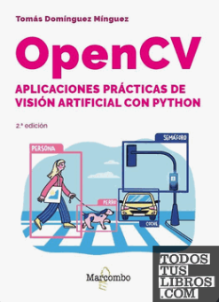
# 1. LECTURA DE LA IMAGEN DESDE LA CARPETA
#### cuando no puede cargar la imagen
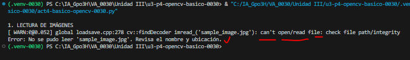
#### cuando puede leer la imagen
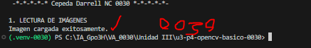
## 2. PROPIEDADES DE LA IMAGEN
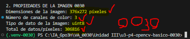
## monstrando imagen original
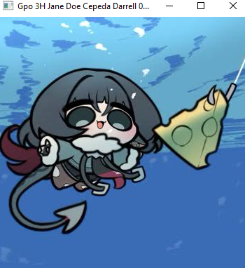
## En la terminal
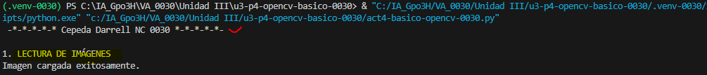
# 4. ACCESO Y MODIFICACION DE PIXELES INDIVIDUALES
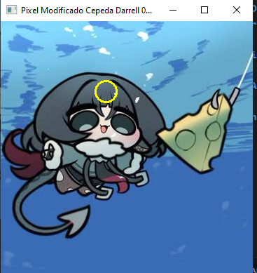
# Imagen ROI marcada
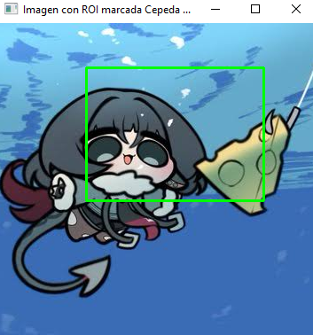
# Imagen ROI marcada y recortada
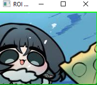
# Canal verde (escala de grises)
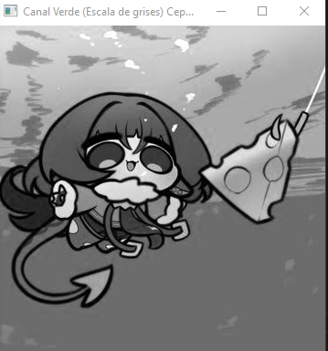
# Canal rojo (escala de grises)
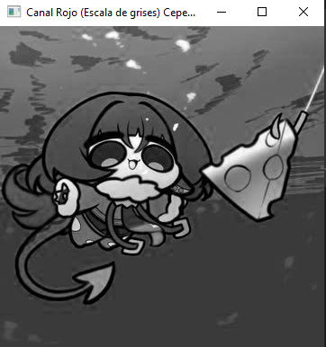
# Canal azul (escala de grises)

# Canal rojo (coloreado)
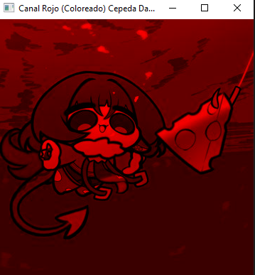
# Canal verde (coloreado)
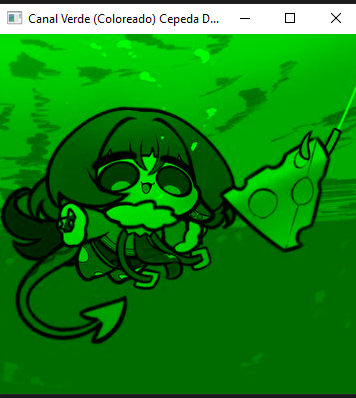
# Canal azul (coloreado)
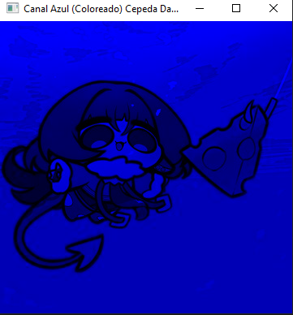
# Redimensionado a 400 x 300
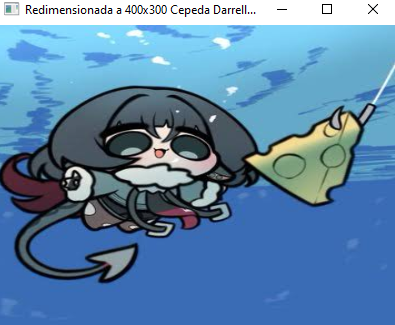
# Mitad de tamaño (0,5%)
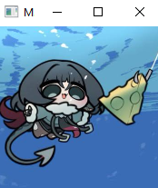
# Ampliada (1,5%)
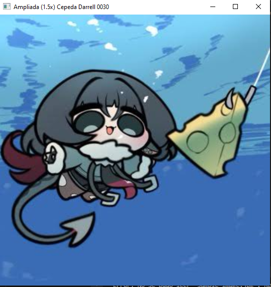
# Imagen rotada (45Grados)
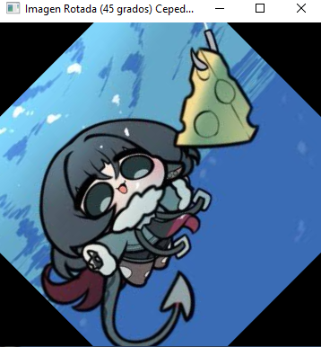
# Imagen volteado en horizontal (espejo)
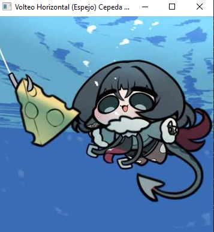
# Volteo vertical (De cabeza)
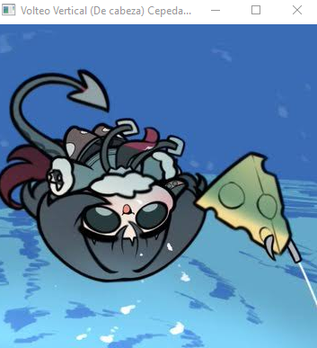
# Volteo en ambos ejes
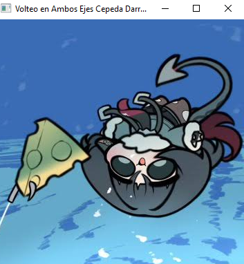
# Terminado con exito
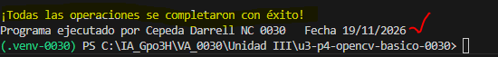